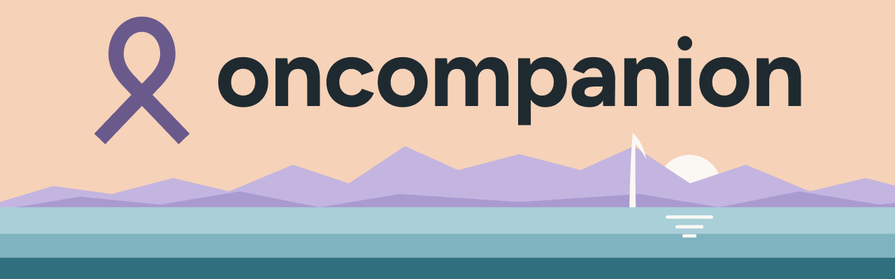
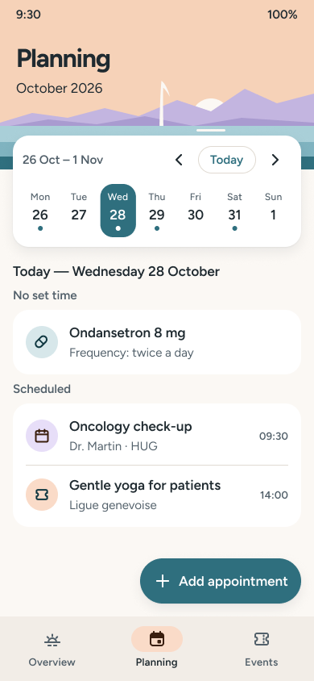
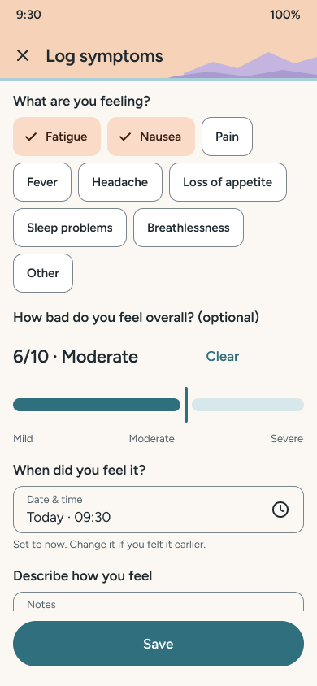
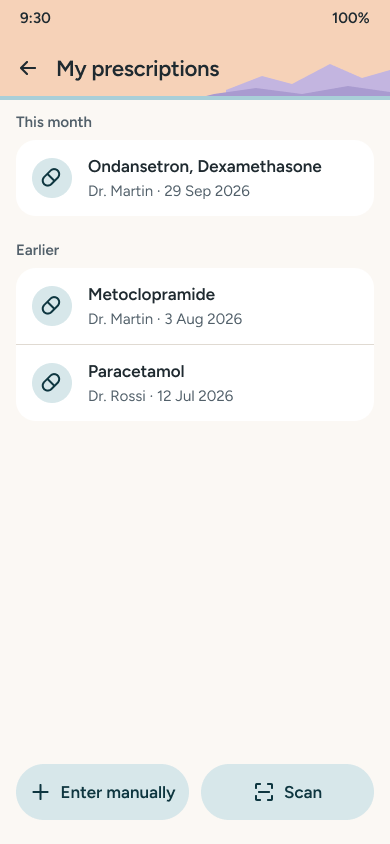
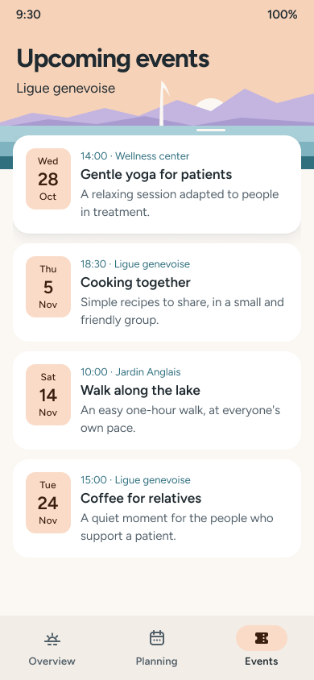
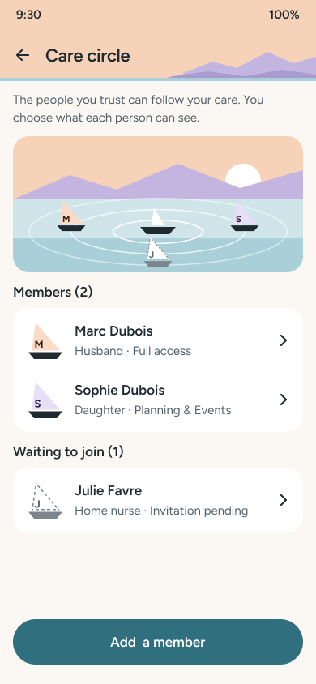
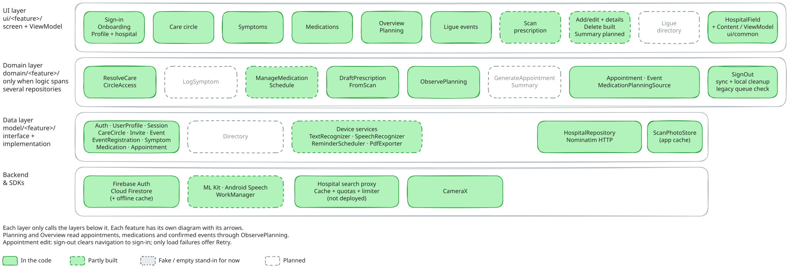

<!-- Co-authored-by: Claude Code <noreply@anthropic.com> -->

<p align="center">
  
</p>

<p align="center">
  <b>Cancer care, kept in one place with as little effort as possible, and shared with the people who help.</b>
</p>

<p align="center">
  <a href="https://github.com/Oncompanion/Oncompanion/actions/workflows/ci.yml"></a>
  <a href="https://sonarcloud.io/summary/new_code?id=Oncompanion_Oncompanion"></a>
  <a href="https://sonarcloud.io/summary/new_code?id=Oncompanion_Oncompanion"></a>
  <a href="https://github.com/Oncompanion/Oncompanion/releases/latest"></a>
</p>

## About

People in active cancer therapy live with exhaustion, "chemo brain" and complicated medication schedules. Too often they rely on memory or scattered paper notes, on exactly the days they have the least energy for it. oncompanion keeps today's care in one place: what's coming up, how they've been feeling, what they take, and who helps them. Relatives in the patient's care circle can follow what the patient shares and, if allowed, log symptoms or add prescriptions for them. Logging takes a tap or two, so it still works on a bad day.

> [!NOTE]
> oncompanion is an organizational tool, **not a medical device**. It makes no diagnosis, gives no medical advice and never changes a treatment. Anything drafted for the patient, such as a scanned prescription, is saved only once they have checked and confirmed it.

## Screenshots

<p align="center">
  
  
  
  
  
</p>

<p align="center"><sub>Designs from our <a href="https://www.figma.com/design/LoQ2CmgkxNQhODegJmo7wd/OnCompanion">Figma file</a>, with fictional data.</sub></p>

## Features

- **Your day at a glance.** The Overview shows the next appointment, today's medications and the events organised by the [Ligue Genevoise Contre Le Cancer](https://geneve.liguecancer.ch/) you signed up for.
- **Planning.** A week calendar of appointments, active medications and confirmed events. Appointments can be added, edited and deleted.
- **Symptom journal.** Tap what you feel, choose how bad it is, add a voice note if you want, and look back over your history.
- **Prescriptions without retyping.** Photograph a prescription and on-device text recognition (ML Kit) drafts it. You check every field before anything is saved. The app warns you when a prescription is already saved or looks like a renewal.
- **Ligue events.** Browse the Ligue genevoise's events and note that you registered with the organizer.
- **Care circle.** Invite relatives with a code and choose which sections each one can see: planning, symptoms, prescriptions, events. You can also let a relative add entries for you, signed with their name. A prescription a relative adds stays unconfirmed until you have checked it.
- **Works offline.** Everything is saved on the phone first and syncs once you're back online. Prescription scanning works offline too.
- **Made for tired days.** Light and dark themes, landscape, and text that stays usable at 200% font size.

**Coming next:** reminders for appointments, events and medications; logging a symptom by voice; a summary of how you've been to show your doctor (on screen or as a PDF); a hospital search in your profile; and the Ligue's directory of contacts and support programs.

## Design

The theme is called *Morning on the lake*. It is warm and quiet, and Lake Geneva is drawn in cut paper behind each screen title, coloured for the time of day. Everyone in the care circle is a small paper boat on the lake. The tokens, components and rules are in [DESIGN.md](DESIGN.md), and every screen with its states is in [Figma](https://www.figma.com/design/LoQ2CmgkxNQhODegJmo7wd/OnCompanion).

## Download

The signed APK is on the [Releases](https://github.com/Oncompanion/Oncompanion/releases) page. A new one is published every Thursday. It requires Android 9 or later.

## For developers

### Tech stack

| | |
| --- | --- |
| App | Kotlin, Jetpack Compose, Material 3, MVVM with manual dependency injection |
| Backend | Firebase Authentication (Google Sign-In), Cloud Firestore with its offline cache, Cloud Functions in TypeScript with App Check |
| On device | ML Kit text recognition, Android speech recognition |
| Tests | JUnit, Robolectric, Compose UI tests, Kaspresso, Firebase emulators |
| Quality | ktfmt, Android lint, JaCoCo, SonarCloud (90% coverage on new code) |

### Architecture

Each feature has a UI layer (screens and their ViewModels), an optional domain layer (use cases combining several repositories) and a data layer (repositories that hide Firebase behind an interface). A caregiver uses the same screens as the patient: every read of patient data goes through one access check, and `firestore.rules` enforces the same check on the server.



The layers, the Firestore layout and one diagram per feature are in [docs/architecture.md](docs/architecture.md).

### Getting started

1. Clone the repository and open it in Android Studio.
2. Build. Gradle runs on Java 25 and downloads it on the first build ([gradle-daemon-jvm.properties](gradle/gradle-daemon-jvm.properties)). The Firebase client config, `app/google-services.json`, is committed on purpose.
3. For tests that touch Firestore or Auth, start the Firebase emulators (Node 22 and the [Firebase CLI](https://firebase.google.com/docs/cli)):

   ```bash
   firebase emulators:start --only auth,firestore --project oncompanion-c4144
   ```

   Tests always use the emulators (Auth on port 9099, Firestore on 8080), never the production project.

### Build and test

```bash
./gradlew ktfmtFormat      # format Kotlin sources (CI fails on ktfmtCheck otherwise)
./gradlew check            # unit + Robolectric tests, lint
./gradlew connectedCheck   # instrumented tests, needs an emulator or device and the Firebase emulators
```

The hospital search proxy in [functions/](functions/) has its own checks and tests; see [functions/README.md](functions/README.md).

### CI and releases

Every pull request runs three jobs ([ci.yml](.github/workflows/ci.yml)):
- **Hospital proxy** checks and tests `functions/`.
- **Checks** runs ktfmt, lint, the unit and Robolectric tests and the release build.
- **CI** runs the connected tests on an emulator with the Firebase emulators, then the coverage report and SonarCloud.

Every Thursday, [release.yml](.github/workflows/release.yml) publishes the signed APK built from the latest green commit on `main`. Its version is `<milestone>.<release number>`.

### Contributing

Read [AGENTS.md](AGENTS.md) first. It covers the architecture rules, code style, tests, commits, pull requests and the Scrum board, for people and coding agents alike. Work on a branch, open a pull request with the [template](.github/PULL_REQUEST_TEMPLATE.md), and merge once it has an approving review and a green CI.

## Acknowledgements

Thanks to the staff of the Ligue Genevoise Contre Le Cancer for validating the problem with us and organizing testing sessions with patients and relatives.
