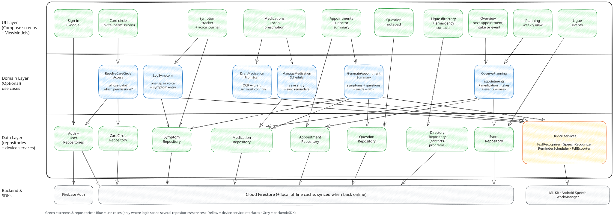

<!-- Co-authored-by: Claude Code <noreply@anthropic.com> -->

# Architecture

Oncompanion follows MVVM with three layers. Arrows point from the caller to what it depends on: the UI calls the domain layer (or the data layer directly when there is no logic to share), and nothing below ever calls up.



Green = screens and repositories, blue = use cases, yellow = device service interfaces (wrapping ML Kit and Android APIs), grey = backend and SDKs, red dashed = P2 stretch goals.

To edit the diagram, open [`architecture.excalidraw`](architecture.excalidraw) on [excalidraw.com](https://excalidraw.com) (Menu → Open), make your changes, then save it back to the same file and export it with *Export image → SVG* (keep "Embed scene" off) to overwrite `architecture.svg`. Commit both files in the same PR as the code change.

## Layers

**UI layer** (`ui/<feature>/`). Each screen is a stateless composable plus a ViewModel that exposes a `StateFlow<UiState>`. ViewModels take their repositories and use cases in the constructor, so tests pass fakes. No Firebase or Android `Context` here. Overview, Planning and Events are the bottom-bar tabs. Overview shows what comes next (the next appointment, medication intake or Ligue event) by taking the first upcoming item from `ObservePlanning`. It is read-only: symptoms are logged from the symptom tracker, not from Overview.

**Domain layer** (`domain/<feature>/`, optional). One class per use case with a single `operator fun invoke(...)`. Only add one when the logic combines several repositories or device services, or is worth unit-testing on its own. Plain reads and writes (questions, directory, events, appointments list) go straight from the ViewModel to the repository.

- `LogSymptom` turns a one-tap entry or a voice transcript into a symptom entry for the right patient, so one-tap entries and the voice journal in the symptom tracker share the same logic.
- `ManageMedicationSchedule` saves a confirmed prescription with its medications and keeps their reminders in sync. All medication writes go through it, so reminders never drift from the stored schedule.
- `DraftMedicationFromScan` returns a *draft* with low-confidence fields flagged. Nothing is saved until the patient confirms it on the review screen.
- `GenerateAppointmentSummary` gathers the symptoms, open questions and medications for an upcoming appointment into a summary the patient can show on screen or export as a PDF (through `PdfExporter`). The patient chooses what goes in it, and it only reports what they logged.
- `ObservePlanning` is the planned integration that will merge appointments, medications and Ligue events for Planning. The current `PlanningRepository` is a read contract with an empty runtime implementation; live aggregation is not implemented yet. Planning has no store of its own: each `PlanningSource` references the feature that owns the data and handles editing.
  - `PlanningTiming.Timed` holds an instant for an appointment or event. `DateOnly` holds a calendar date for an active medication; it is not a scheduled intake, and its day does not shift with the display zone. Medication frequency is recorded free text and is never interpreted into times or doses.
  - `PlanningRange` specifies inclusive/exclusive calendar dates and a display zone, with derived instant boundaries for timed queries. Future adapters emit only occurrences in that range. Medication expansion must be bounded to it, using `startDate` and `durationDays`; a row describes the recorded active period, not a claim that a dose is due on that day. Non-daily free-text frequency remains visible without interpreting it.
  - The selected-day agenda shows date-only medications first under “No set time”, then appointments/events under “Scheduled” in time order. Keys include source IDs and occurrence date/time, independent of editable text. Frequency is separate from appointment/event subtitle text.
  - Future aggregation reads `MedicationRepository.observeMedications(uid)`, never Firestore directly. It must cancel/clear patient-specific observations on account changes and use local-cache flows. Events need a defined source time zone and a range-capable repository for past-week browsing; the current upcoming-only event contract does not provide history. Overview's current time-required model must also support date-only entries before sharing this data. No fake medication time or taken/overdue status is introduced.
  - Repositories are injected through the existing screen/ViewModel boundary. Tests and previews supply mixed entries; production still supplies an empty source. No new collection, layer or dependency is introduced by the mixed-entry contract.
- `ResolveCareCircleAccess` decides whose data the current user is looking at (their own, or a patient who shared with them) and what they are allowed to see. Every screen that shows patient data asks it for the target `uid`, so caregiver mode is not a separate code path.

**Data layer** (`model/<feature>/`). Data classes, a repository interface, and its Firestore implementation (`SymptomRepository` / `SymptomRepositoryFirestore`). Ligue events have their own `EventRepository`, separate from the directory of contacts and programs. Device services (`TextRecognizer`, `SpeechRecognizer`, `ReminderScheduler`, `PdfExporter`) follow the same interface + implementation pattern, so domain code never touches ML Kit or Android APIs directly.

## Offline mode

Firestore's local cache is the offline store: writes are applied locally right away and synced when the connection returns, and repositories expose `Flow`s from snapshot listeners so the UI updates either way. No separate Room database is needed. Text recognition, reminders and on-device speech work without a network.

## Care circle invitations

A patient adds someone to their circle before that person has an account, but member documents are keyed by the member's uid (`/users/{uid}/circle/{memberUid}`), which only exists once they sign in. So **a pending member is an invitation, and a member is someone who accepted one**:

- `/invites/{inviteCode}` holds what the patient decided about the person (first name, family name, relationship, permissions) and the email to send the invitation to. The patient creates it, offline if needed.
- `/users/{patientUid}/circle/{caregiverUid}` is created **only when the caregiver redeems the code**, as a copy of the invite. `memberUid` keeps meaning the member's uid, so rules can still check `circle/{request.auth.uid}` with a single `get()`.
- `/users/{caregiverUid}/patients/{patientUid}` is the caregiver's own list of the circles they joined, created in the same write.

We didn't store pending members in `circle/` and move them on join (the document ID would change, and a caregiver would have to create and delete docs in the patient's circle), or give members a generated ID plus a separate uid link (every collection's rules would need two lookups).

**What each side sees.** Each user can only read their own profile, so what the other side needs is copied:

| When | What is copied | From → to | Why |
|---|---|---|---|
| Invite created | the patient's first name | profile → `invites/{inviteCode}.ownerFirstName` | The caregiver must know whose circle they are joining, and can't read the patient's profile |
| Code redeemed | name, relationship and permissions | invite → `circle/{caregiverUid}` | The patient keeps seeing the name they typed, like a phone contact |
| Code redeemed | the caregiver's account email | `request.auth.token.email` → `circle/{caregiverUid}.email` | A reliable contact that the rules check, so it can't be faked |
| Code redeemed | `ownerFirstName` | invite → `patients/{patientUid}.patientFirstName` | The caregiver lists their patients without reading their profiles |

There are two emails: `invites/{inviteCode}.email` is where the patient sends the invitation (typed, optional, editable while pending), and `circle/{memberUid}.email` is the caregiver's Google account email, set when they join and read-only for the patient. Before joining there is no account to read it from, and after joining the account email is the one to trust. The caregiver's join screen tells them that the patient will see their email.

**Invite codes.** The code is the document ID: 10 characters from an alphabet without 0, O, 1, I and L (they are read aloud and typed), generated on the phone with `SecureRandom`, and shown as `ABCDE-FGHJK`. Anyone signed in may `get` an invite by its code, but only its owner may `list` theirs, so codes can't be enumerated. A code is valid for 7 days from the **server** `createdAt` and can be used once: `redeemerUid` goes from null to the caregiver's uid, and never changes after that. Invalid, used and expired codes give the same error. Joining requires a profile with role `CAREGIVER`.

**Redeeming is the one write that needs the network.** Only the server knows whether a code is valid, unused and unexpired, and a local "you joined" that the server later rejects would show someone's data and then take it away. So the caregiver's repository reads the invite from the server and commits one batch, waiting for the server to confirm it: the new `circle/{caregiverUid}` doc, `redeemerUid` on the invite, and the new `patients/{patientUid}` doc. The rules check each of these against the others (`get` for the invite before the batch, `getAfter`/`existsAfter` for the result). Everything else (creating, editing or cancelling an invite, editing or removing a member) works offline. An invite created offline only exists on the patient's phone until it syncs, so the app says the code will work once the phone reconnects (`hasPendingWrites()`).

**Removing a member** is one batch written by the patient: it deletes `circle/{memberUid}`, the caregiver's `patients/{patientUid}` doc and the used invite, so neither a stale link nor the typed name and email are left behind. Cancelling a pending invite deletes it; renewing an expired one creates a new invite with the same details and deletes the old one.

Known limitations:
- Revoking access while the patient is offline only takes effect once their phone syncs.
- If the patient changes their first name, caregivers keep the old one. It's a display label, and updating it would need writes into other users' data.
- Someone with a patient account can't join a circle; they would need to sign in with another Google account.
- An expired invite stays in the patient's list until they cancel or renew it, since there is no server code to clean it up.

## Sign-out

Profile asks for confirmation before reusing `AuthRepository.signOut()`. Its ViewModel drops profile details and cancels the profile listener as soon as Firebase sign-out returns, then asks the existing Google credential provider to clear the account-picker state. Credential cleanup is best effort, as in sign-in; an immediate authentication error keeps the user on Profile with retry available.

The host opens the Auth graph with `navigateAndClearBackStack`. That helper also clears saved bottom-tab stacks, so both active and saved authenticated ViewModels are destroyed and cannot be restored by Back or a later session. Profile observation is keyed to the currently authenticated uid; with no signed-in user it never requests a cached profile.

Firestore disk persistence is retained, including pending offline writes. Signing out makes cached data inaccessible through the app's navigation and Profile state; it does not securely erase the SDK's disk cache. `clearPersistence()` requires a stopped Firestore instance and also deletes pending writes, so physical cache clearing from US-19 subtask #35 needs a separate decision compatible with offline mode. No Firebase rules or persistence settings are changed by sign-out.

## Firestore layout

```
/users/{uid}                          profile (owner only)
/users/{uid}/symptoms/{id}
/users/{uid}/prescriptions/{id}       doctor, date and the list of its medications
/users/{uid}/appointments/{id}
/users/{uid}/questions/{id}
/users/{uid}/circle/{memberUid}       permissions granted to a care-circle member
/users/{uid}/patients/{patientUid}    circles this caregiver joined
/invites/{inviteCode}                 pending care-circle members (invitations)
/directory/{contacts|programs|events}/items/{id}   read: signed in, write: staff
```

Care-circle members read a patient's data through rules that check `/users/{uid}/circle/{request.auth.uid}`. Staff status comes from a custom claim set by the team, never from a field users can write.

A prescription is one document: the prescribing doctor and the date, stored once, and the list of its medications, each with its own ID, start date and duration. A prescription and its medications are always written together (one form, one use case), so keeping them in one document makes saving, replacing or deleting a prescription a single write. It can't be half saved, and its medications can't be partly known by a device that is offline, mixed when two devices edit at once, or left behind after a deletion. Planning, reminders and the appointment summary still work on single medications: the repository reads them out of the prescriptions, so they never deal with a prescription. Anything recorded per intake later (e.g. a medication marked as taken) would go in its own collection, not in the prescription.
