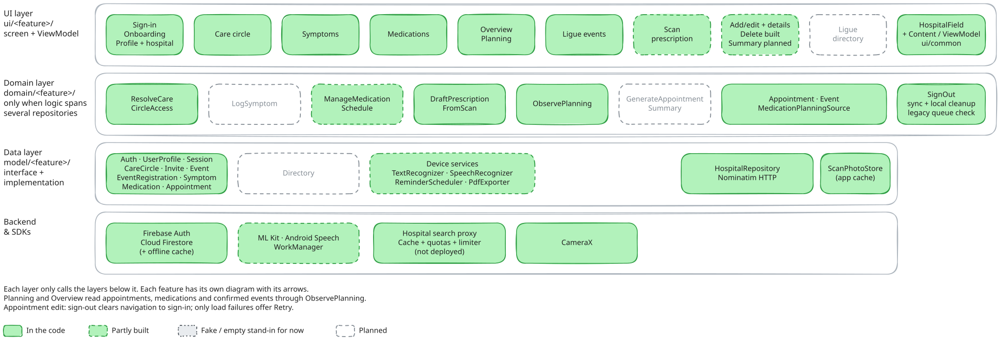
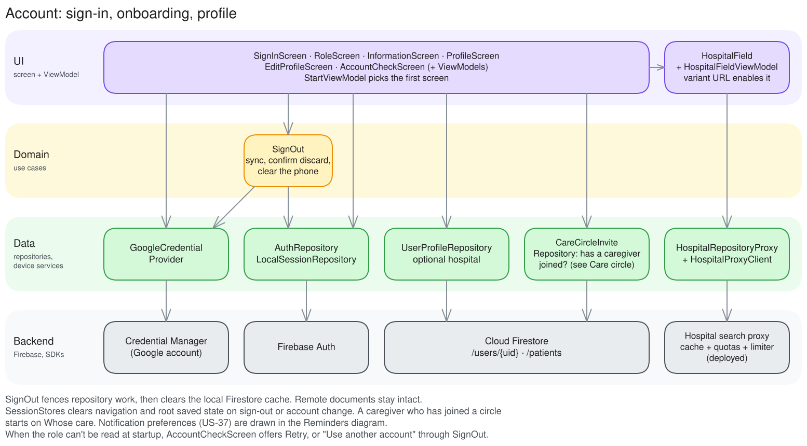
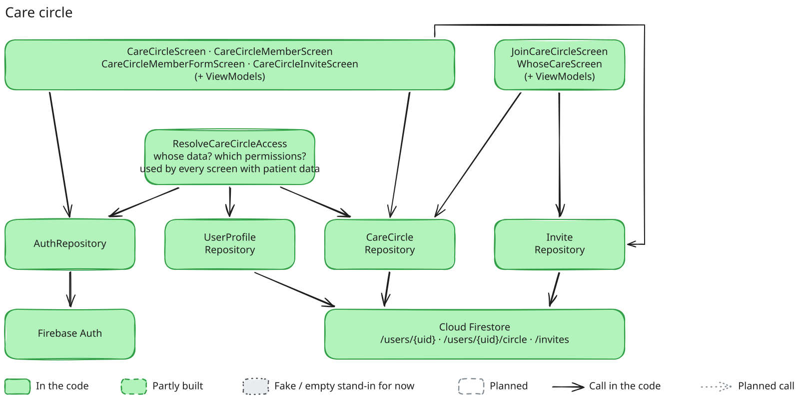
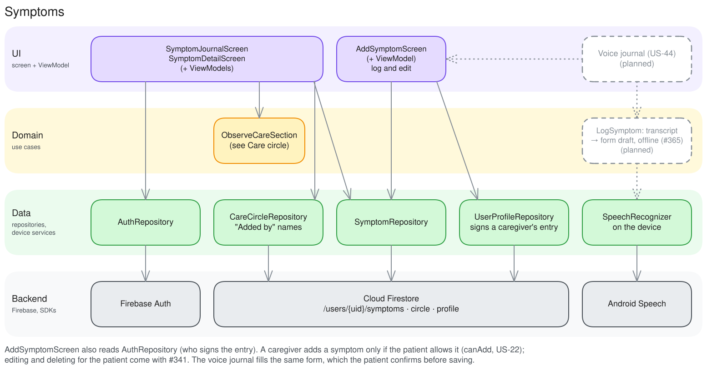
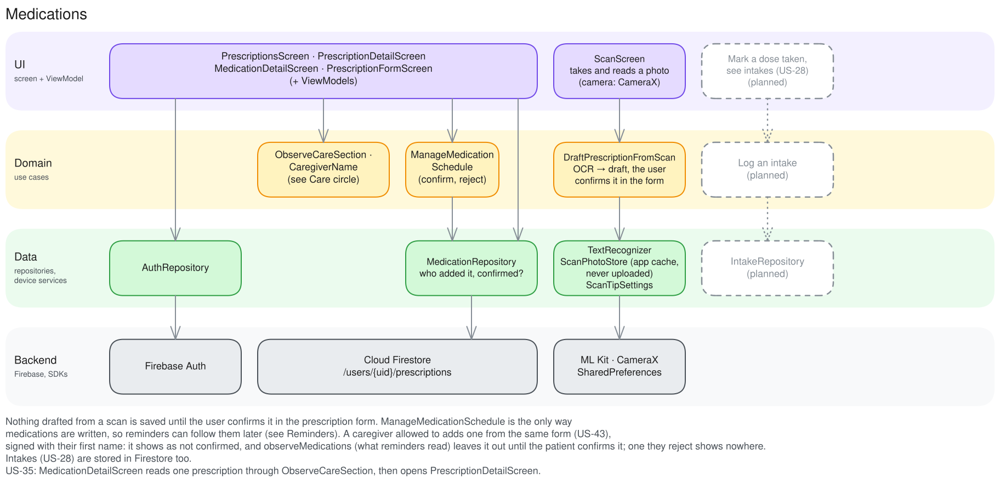
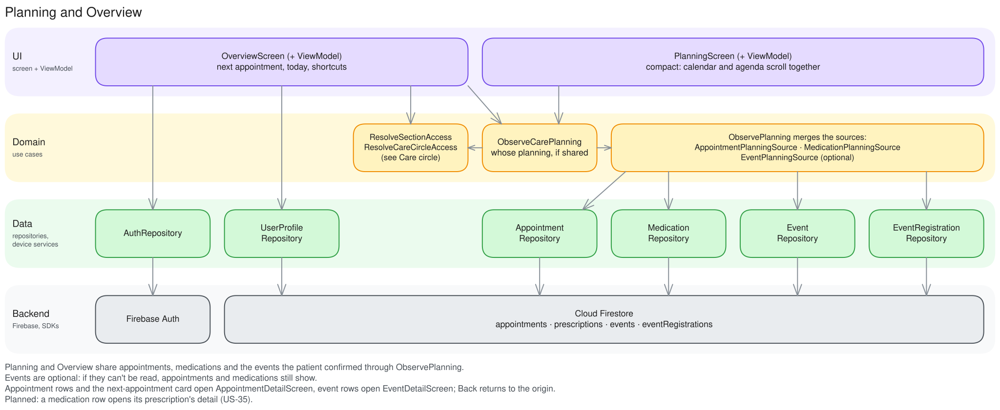
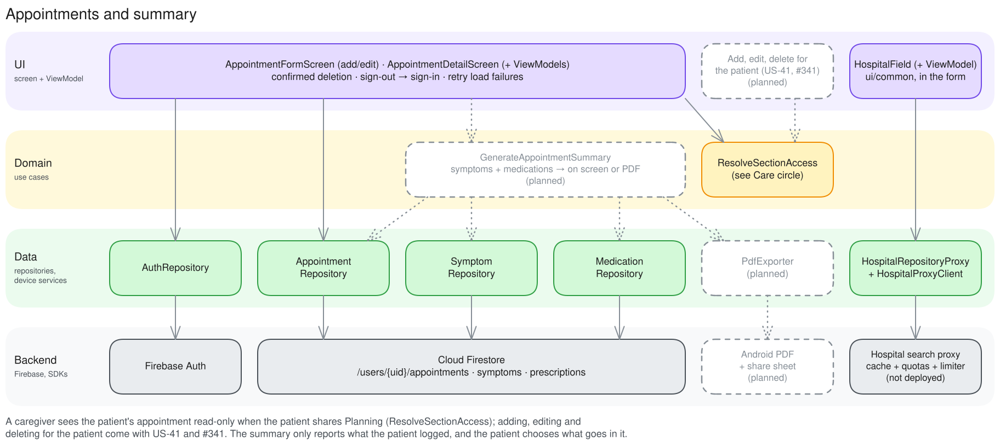
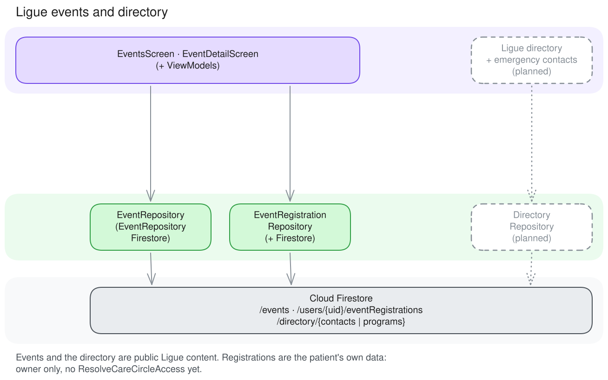
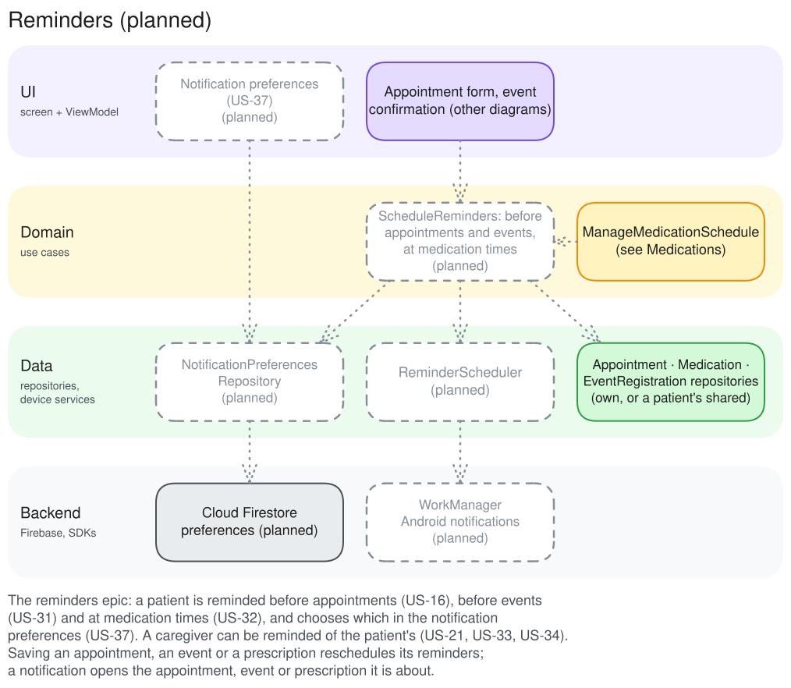

<!-- Co-authored-by: Claude Code <noreply@anthropic.com> -->
<!-- Co-authored-by: ChatGPT <noreply@openai.com> -->
<!-- Co-authored-by: Codex <noreply@openai.com> -->

# Architecture

Oncompanion follows MVVM with three layers. Arrows point from the caller to what it depends on: the UI calls the domain layer (or the data layer directly when there is no logic to share), and nothing below ever calls up.

The overview shows how the app fits together, with the calls between its layers (#264). Each feature then has its own diagram below, with its classes, read from its screens (top) down to the backend (bottom).



Every diagram names its four layers and gives each one colour: screens and ViewModels in violet, use cases in yellow, repositories and device services in green, Firebase and the SDKs in grey. Arrows are calls and go down. Planned parts are grey dashed boxes that say "(planned)", and dotted arrows are planned calls. The overview follows two core flows, numbered on their arrows:

1. **A write works offline.** A screen writes through its repository to Firestore's cache on the phone, so the change shows at once, and the cache *syncs when online*. If the server's rules refuse a write, Firestore undoes it on the phone and the repository reports it to `RejectedWrites`; the app-wide snackbar *shows refused writes* to the user (see "Rejected writes" under Offline mode).
2. **A caregiver only sees what is shared.** A screen showing a section of a patient's data reads it through `ObserveCareSection` (Planning and the Overview through `ObserveCarePlanning`), which asks `ResolveSectionAccess`; that uses `ResolveCareCircleAccess` and the care circle to check *is the section shared?*, then reads the data by the patient's uid. `firestore.rules` check the same on the server.

The overview also shows the large planned areas (the voice journal, reminders, a caregiver writing for the patient); each feature diagram draws the planned parts of its feature, and the reminders epic has its own diagram.

To edit a diagram, open its `.excalidraw` file on [excalidraw.com](https://excalidraw.com) (Menu → Open), make your changes, then save it back to the same file and export it with *Export image → SVG* (keep "Embed scene" off) to overwrite its `.svg`. Coding agents edit the `.excalidraw` JSON directly instead (see [AGENTS.md](../AGENTS.md)) and regenerate the `.svg` files with `npm ci && npm run export` in `scripts/diagrams` (Node 20 or later), which gives the same result as excalidraw.com. Commit both files in the same PR as the code change, and give a planned box its layer's colour once it is built.

## Layers

**UI layer** (`ui/<feature>/`). Each screen is a stateless composable plus a ViewModel that exposes a `StateFlow<UiState>`. ViewModels take their repositories and use cases in the constructor, so tests pass fakes; the defaults come from one provider object per repository (`XRepositoryProvider.repository`), the only place that names an implementation. No Firebase or Android `Context` here. Overview, Planning and Events are the bottom-bar tabs. Overview shows what comes next (the next appointment, medication intake or Ligue event) by taking the first upcoming item from `ObservePlanning`. It is read-only: symptoms are logged from the symptom tracker, not from Overview.

**Domain layer** (`domain/<feature>/`, optional). One class per use case, usually with a single `operator fun invoke(...)`. Only add one when the logic combines several repositories or device services, or is worth unit-testing on its own. Plain reads and writes (directory, events, appointments list) go straight from the ViewModel to the repository.

- `LogSymptom` is planned with the voice journal. The add symptom form saves through `SymptomRepository` directly for now. For a caregiver logging for the patient (US-22), it also reads `AuthRepository` and `UserProfileRepository` to sign the entry with their uid and first name; that signing stays in the form until the voice journal needs it too, then moves to `LogSymptom`. A voice transcript is turned into a `SymptomDraft` by the pure function `parseSpokenSymptom` (`domain/symptom`, no repository): the draft fills the same form, which the patient checks before saving. The rule for when a symptom was felt (`occurredAt`) stays in `AddSymptomViewModel.kt`, since every symptom, dictated or typed, is saved by the form.
- `similarPrescription` (US-39) compares a new prescription with the saved ones, by name and dosage of its medications (ignoring case, accents, spaces and order): the same date and prescriber make it the **same** prescription, and the prescription form asks before saving it again; another date makes it a likely **renewal**, said above the form without blocking. It is a plain function, not a use case: the form already reads the saved prescriptions (`observePrescriptions`, from the cache when offline), and only compares a new prescription, never a correction.
- `ManageMedicationSchedule` saves a confirmed prescription with its medications and keeps their reminders in sync. All medication writes go through it, so reminders never drift from the stored schedule; that is why it exposes three named operations (`add`, `update`, `delete`) instead of a single `invoke`.
- `DraftPrescriptionFromScan` reads the photo of a scan with the `TextRecognizer`, then returns a `ScanOutcome`: the *draft* with the details to check flagged (`readPrescription`), no text (nothing read, or reading failed), or not a prescription (text read surely but no medication, like a label), so the screen tells the patient which. Nothing is saved until the patient confirms the draft in the form. It is in `domain/` because it builds a `PrescriptionDraft`, while the reading steps it relies on (below, "Prescription scan") are in `model/`.
- `GenerateAppointmentSummary` gathers the symptoms and medications for an upcoming appointment into a summary the patient can show on screen or export as a PDF (through `PdfExporter`). The patient chooses what goes in it, and it only reports what they logged.
- `ObservePlanning` merges the Planning sources into one list sorted by day and time: appointments (`AppointmentPlanningSource`) and the Ligue events the patient confirmed (`EventPlanningSource`, US-30), which combines that person's confirmations (`EventRegistrationRepository`) with the events of the displayed range (`EventRepository`), past weeks included. Medications use `MedicationPlanningSource`. Ligue events are optional: `PlanningRepositoryProvider` wraps them in `OptionalPlanningSource`, so if they fail to load they are left out and Planning still shows the rest. Appointments and medications are essential: if one of them fails, the whole list fails and Planning offers a retry, rather than a calendar that silently misses a medical appointment. `PlanningRepository.observeItems(ownerUid, range)` reads one person's planning; `AppointmentPlanningSource` and `MedicationPlanningSource` adapt that person's cached appointments and medications to the requested date range, and `EventPlanningSource` reads that person's confirmations, so a caregiver sees the events their patient confirmed. Production Planning uses `ObservePlanning` over all three sources through `PlanningRepositoryProvider`.
- `ObserveCarePlanning` decides whose planning Planning and the Overview show, so caregiver mode (US-20) is the same code path. It asks `ResolveSectionAccess`, which every screen showing one section of patient data uses: the user's own data is `Readable` and editable once they are signed in (also offline before their profile is on the device), and a followed patient's goes through `ResolveCareCircleAccess`, `Readable` but not editable when the patient shares the section, `NotShared` otherwise. It then reads the planning of that `ownerUid`. The symptom journal and detail, the prescriptions list and detail, and the caregiver's appointment page read their section through `ObserveCareSection` (#323), so none maps the access to its own flags: it emits `Loading` (with whether adding may be offered already), `Shown(data, canEdit, canAdd)`, `NotShared`, `NoAccess` or `Failed`. A read failure doesn't end it, so a later access change still applies, e.g. "not shared" when the server refuses the open read before the patient's change arrives. The symptom journal and detail use it for `SYMPTOMS`: a caregiver reads the patient's symptoms with no edit or delete action, and adds one only if the patient allows it (`canAdd`, US-22), sees "Anne doesn't share Symptoms with you" otherwise, and gets the Overview's Symptoms shortcut only when it is shared. The prescriptions list and detail do the same for `PRESCRIPTIONS`, with no scan, add, edit or delete for a caregiver, and the appointment page shows a caregiver the patient's appointment read-only when they share `PLANNING`. It emits `Loading` (access or entries not known yet), `Shown(items)`, `NotShared` (the followed patient doesn't share their planning: the screens say "Anne doesn't share Planning with you"), `NoAccess` (signed out, or not in the circle) or `Failed` (a read error, with Retry). An account or access change starts over from `Loading`, so the previous person's entries never show for the next one, and a read failure doesn't stop it: the next account still loads. `PlanningViewModel` and `OverviewViewModel` take it with the chosen patient's uid from navigation (null for the user's own planning); their clock and display zone default to the system settings. Planning has no store of its own: each `PlanningSource` references the feature that owns the data and handles editing.
  - `PlanningTiming.Timed` holds an instant for an appointment or event. `DateOnly` holds a calendar date for an active medication; it is not a scheduled intake, and its day does not shift with the display zone. Medication frequency is recorded free text and is never interpreted into times or doses.
  - `PlanningRange` specifies inclusive/exclusive calendar dates and a display zone, with derived instant boundaries for timed queries. Future adapters emit only occurrences in that range. Medication expansion must be bounded to it, using `startDate` and `durationDays`; a row describes the recorded active period, not a claim that a dose is due on that day. Non-daily free-text frequency remains visible without interpreting it.
  - The selected-day agenda shows date-only medications first under “No set time”, then appointments/events under “Scheduled” in time order. Keys include source IDs and occurrence date/time, independent of editable text. Frequency is separate from appointment/event subtitle text.
  - `MedicationPlanningSource` reads `MedicationRepository.observeMedications(uid)`, never Firestore directly. Each snapshot replaces the occurrences within the requested range: start date included, duration end excluded, and missing duration bounded by the range. Editing or deleting a prescription updates these derived rows without a second store. The Overview reads the same planning data: the next appointment and today's entries, date-only ones without a time or a status. No fake medication time or taken/overdue status is introduced.
  - Repositories are injected through the existing screen/ViewModel boundary. Tests and previews can supply mixed entries; production supplies appointments and medications through their respective sources. No new collection, layer or dependency is introduced by the mixed-entry contract.
- `ResolveCareCircleAccess` decides whose data the current user is looking at (their own, or a patient who shared with them) and what they are allowed to see. Every screen that shows patient data asks it for the target `uid`, so caregiver mode is not a separate code path. It combines `AuthRepository`, `UserProfileRepository` and `CareCircleRepository`, and is called with the chosen patient's uid (`null`, or the user's own uid, for their own data). The profile role limits what may be asked: a patient only sees their own data, and a caregiver only a patient whose circle they are in. It returns a live `Flow<CareAccess>`:
  - `Granted(ownerUid, sections, isOwn)`: the uid to read and the `CarePermission` sections that may be shown. The patient's own data has every section and `canEdit`; a caregiver gets the sections in their member document (`/users/{patientUid}/circle/{uid}`) and never `canEdit`.
  - `Denied` when the caregiver isn't in the patient's circle (removed, never added, or their member document is malformed), or the role doesn't allow it (a caregiver asking for their own data, a patient asking for someone else's), or nobody is signed in.
  - `Unconfirmed` when this device has no record of the user's profile, or of the caregiver's member document, and the server hasn't confirmed it yet (e.g. just joined, a second phone, or signed in again). It shows no patient data and becomes `Granted` or `Denied` once the server confirms. Screens show it as "checking access". The caregiver's access comes from `CareCircleRepository.observeMembership`, which tells a missing document confirmed by the server (`NotMember`) from one the server hasn't confirmed yet (`Unconfirmed`); `observeMember`, used by the care circle screens, is unchanged.
  - It re-emits when the user signs in or out, or the patient changes this member's permissions or removes them, so open screens follow. An account change cancels the previous account's member listener. A member document this device has a record of answers right away from the local cache. Known limit: the Firestore cache can't tell a deleted member document from one it never fetched, so a removal this device already saw also shows `Unconfirmed`, not `Denied`, until the server answers; no data is shown meanwhile. It fails like the repositories' flows when the profile or the circle can't be read, so screens keep their usual retry. It only decides what the UI shows and offers: `firestore.rules` are the real gate on what can be read and written (per-section member reads come with #135's rules change).

**Data layer** (`model/<feature>/`). Data classes, a repository interface, and its Firestore implementation (`SymptomRepository` / `SymptomRepositoryFirestore`). Ligue events have their own `EventRepository`, separate from the directory of contacts and programs. The patient's confirmations that they registered for an event with its organizer (US-25) are in `EventRegistrationRepository`: one document per event, keyed by the event's id, so confirming twice never creates a duplicate. Oncompanion only records what the patient says; registering stays on the organizer's website, linked from the event's `websiteUrl`. Device services (`TextRecognizer`, `SpeechRecognizer`, `ReminderScheduler`, `PdfExporter`) follow the same interface + implementation pattern, so domain code never touches ML Kit or Android APIs directly.

## External hospital search (issue #142)

`model/hospital/HospitalRepository` accepts explicitly submitted search text and returns
`HospitalSearchResult`: a list of hospitals (possibly empty), or a typed network, service,
rate-limit or invalid-response error. Future ViewModels inject this interface; screens never
access HTTP. `HospitalRepositoryNominatim` uses platform `HttpURLConnection` on the IO
dispatcher and Android JSON parsing, with no new dependency. `FakeHospitalRepository` in
`app/src/test/.../model/hospital` supplies configurable outcomes and records submitted queries.
Hospital identities use OSM object type and ID rather than provider-specific place IDs.

`HospitalRepositoryProvider` follows #177's replaceable `@Volatile repository` convention.
Deployment wiring can call `configure(searchEndpoint)` before creating field ViewModels to install
one shared `HospitalRepositoryProxy`, preserving its cache and retry gate across consumers. There is no public
service URL or placeholder URL by default: until configured, blank searches return an empty success
and other searches return the existing service error without HTTP. Tests replace `repository` with
`FakeHospitalRepository` and restore the original in `@After`. Configuring the provider does not
implement or deploy the required proxy.

The [official Nominatim usage policy](https://operations.osmfoundation.org/policies/nominatim/)
prohibits autocomplete. The future field (#143) must use an explicit Search button, with no
keystroke, background, periodic or automatic nearest-hospital requests. Only public hospital
names and locations may be submitted; never include patient details or confidential data.
Every results view must display `© OpenStreetMap contributors`, linked to
[the copyright and ODbL information](https://www.openstreetmap.org/copyright), including cached
results. The repository exposes attribution constants for consumers; #142 adds no UI.

The legacy `HospitalRepositoryNominatim` implementation, no longer selected by the provider,
identifies itself as `Oncompanion/1.0` with the project URL, sets
10-second connection/read timeouts, disables redirects and automatic retries, and bounds
response size. All repository instances share a process-wide mutex with a conservative
one-second gap after a request completes (including failures). Each instance caches the last
50 successful distinct queries, including empty results, for its lifetime. Failures are not
cached and cancellation propagates. Cache misses require connectivity; this is not a Firestore
store and does not change essential offline features.

**Deployment prerequisite:** the public service's maximum of one request per second applies
to aggregate traffic across all app users, not each device. A local throttle cannot enforce
that limit. The constructor therefore requires an HTTPS search endpoint instead of defaulting
to the public service. Before wiring this into a released UI, supply a deployment-configured
proxy that enforces the aggregate limit, caches requests and can switch its upstream provider
without an app update, as the policy requires. Proxy deployment/configuration is outside #142;
the repository is not yet wired into production. No profile fields, Firestore rules, hospital
field UI (#143), or profile integration (#144) are added.

## Shared hospital search proxy

`functions/` implements the hospital-only JSON v2 endpoint using TypeScript and second-generation
Firebase Functions. The HTTP adapter validates the existing Android request contract, verifies
Firebase Authentication and App Check, and calls a provider-independent `HospitalSearchService`.
The service depends on a shared-store interface and an upstream-client interface; the Firestore
adapter implements caching and global coordination, and `NominatimClient` owns the fixed upstream.
Before global acquisition, a transaction
enforces ten initial shared-cache misses per rolling hour and fifty per rolling day per user.
`hospitalSearchQuota/{HMAC-SHA256}` retains bounded miss timestamps with one-day TTL using a
server-only Secret Manager key; raw UIDs never enter search storage. Cache expiry also has a
deployable TTL policy; logical expiry remains enforced.
The Account, Appointments and overview diagrams identify this implemented but undeployed backend.
The repository-to-proxy client path is implemented and opt-in; the service remains undeployed.

`hospitalSearchCache/{sha256}` stores only projected hospital results and a seven-day expiry;
`hospitalSearchControl/nominatim` holds the exclusive owner or server-timestamp cooldown. Both
collections remain inaccessible to mobile clients under the existing default-deny rules. They
contain no user IDs or raw search queries. They are backend stores, independent of Android's
in-memory repository cache and Firestore's offline SDK cache.

A transaction admits only one upstream owner, with no automatic lock expiry. After completion,
a server timestamp starts a minimum one-second cooldown, measured using Firestore read timestamps.
Idempotent release retries recover transient storage failures without sending HTTP again.
A crashed owner or persistent release failure blocks further misses until safe operator recovery.
This deliberately trades
availability for compliance under paused instances and overlapping revisions. See the
[backend runbook](../functions/README.md) for the guarantee, recovery procedure, tests and setup.

`HospitalRepositoryProxy` adapts `HospitalProxyClient` to the existing `HospitalRepository`
contract. It shares the last 50 trimmed successful queries (including empty results), deduplicates
OSM identities, coalesces identical concurrent searches and returns cached public results offline.
Uncached requests use only the authenticated proxy, with no direct-provider fallback. Typed client
network/timeout, invalid-response and rate-limit failures map to the matching existing repository
errors; authentication, App Check, configuration and other server failures map to SERVICE and the
existing manual-entry feedback. HTTP/JSON/token handling remains entirely in the client.

A monotonic retry gate blocks all uncached queries in the shared adapter for the full parsed
Retry-After delay; cache hits remain available. No timer sends another request. BeyondLimit retains
the block for that adapter's lifetime instead of shortening the provider wait. Configure the provider
once before creating field ViewModels; endpoint changes/disable require recreating existing consumers.
The prior local HTTP repository remains legacy code for its tests, not an integrated search path.

`FirebaseHospitalProxyTokens` still obtains Auth/App Check tokens lazily; production has no endpoint
configured by this change. Profile Search is enabled only for an installed proxy adapter. The existing
HospitalFieldViewModel owns explicit Search actions and stale-result cancellation, while edits,
selection, saving and leaving Profile clear obsolete feedback. Calls join `SessionAccess.operation`.
See [Android proxy setup](hospital-proxy-client.md) for registration and the opt-in configuration API.
The backend CI job runs type, format, unit and demo Firestore tests. `onCall` remains a team
decision before Android integration: it improves token handling and URL privacy but requires a
new Android SDK and transport contract. See the backend runbook for the comparison.
No production deployment or automatic Functions deployment workflow is included.

## Reusable hospital field (issue #143)

`ui/common/HospitalField` is an outlined free-text location field with an explicit Search button.
The form owns its text and structured selection. `onValueChange(String)` supports unrestricted
manual entry. Selecting a result sends its name through `onValueChange`, then the complete existing
`Hospital` through `onHospitalSelected(Hospital?)`. Manual edits send `null` before the text callback
so the parent clears any previous structured selection, including for empty or unmatched text.
Parents also clear their selection when changing text externally and decide which hospital details
to persist. Search outcomes never replace text or emit a selection. `HospitalFieldContent` renders
idle, loading, results, empty and error states without a service. `HospitalFieldViewModel` exposes one state flow and
receives a `HospitalRepository`, defaulting to `HospitalRepositoryProvider.repository`. Tests can
still inject a fake directly. Each field needs its own lifecycle-scoped ViewModel, which retains the
repository captured at construction so later provider replacements do not discard its cache. It never
checks connectivity before searching, so repository cache hits remain available offline. Cache misses report a short error while manual entry stays usable.

Editing, external text changes, disabling or removing the field cancels obsolete requests and
clears feedback. A generation check discards late responses. Successful lookups show linked
OpenStreetMap attribution, including empty and cached results. The field has no screen-specific
navigation, patient data or persistence. Profile supplies the stateful HospitalField through a composable slot in its stateless form;
Add Appointment integration remains a separate task. The deployment prerequisite for a configurable, aggregate-rate-limited proxy
from #142 still applies.

The Account and Appointments diagrams show the reusable HospitalField (with its
HospitalFieldViewModel) → HospitalRepositoryProxy path; the overview shows it from the profile. Edit Profile's search ViewModel connection is implemented behind provider configuration;
Add Appointment integration remains planned.

## Optional profile hospital (issue #144)

`UserProfile.hospital` is nullable text, limited to `MAX_HOSPITAL_LENGTH = 100`. Firestore's
`hospital` field is optional: missing, null and empty strings are accepted, with non-string and
oversized values denied by `isValidProfile`. Repository validation uses the same model limit.
Missing fields deserialize to null. As with family name and cancer type, new and updated profiles
write a null field when no hospital is supplied. Edit Profile trims text and saves blank input as
null; updating uses `update()` and retains role, creation time and unrelated document fields.

Profile displays only a nonblank saved hospital. Patient Edit Profile drafts initialize from the
saved hospital, track hospital edits separately from incoming snapshots, and allow adding, editing
or clearing it. Empty hospital text never makes Save unavailable. Input is bounded by the shared
model limit like the existing fields. Caregivers gain no hospital editor.

Edit Profile reuses `HospitalField` with its existing HospitalFieldViewModel; the shared field owns
search state and lifecycle cancellation. The stateless form accepts a field slot and defaults to manual entry. `HospitalRepositoryProvider.isConfigured` enables Search only for the proxy
adapter. With no configured endpoint, Search remains visible and disabled and manual text stays
editable. Content defaults remain manual-only for standalone callers/tests. No endpoint, feature
flag service or production resource is created here; deployment must call `configure(proxyUrl)`
before ViewModels are built. Profile retains its existing validation, persistence and navigation.

The Account, Appointments and overview diagrams identify the proxy adapter/client path. The Account
search connection is implemented but conditional; backend deployment and Add Appointment wiring
remain separate work.

## Feature diagrams

### Account



### Care circle



### Symptoms



### Medications



### Planning and Overview



### Appointments and summary



### Ligue events and directory



### Reminders (planned)



## Offline mode

Firestore's local cache is the offline store: writes are applied locally right away and synced when the connection returns, and repositories expose `Flow`s from snapshot listeners so the UI updates either way. No separate Room database is needed. Text recognition, reminders and on-device speech work without a network.

**Rejected writes (#248).** Because writes return once saved on the device, the server can still reject one later (security rules, revoked access). Firestore then undoes it on the device: a deleted item comes back, an edit is reverted. Every repository that writes this way (symptoms, medications, appointments, the user profile, the care circle, its invites and event registrations) reports each rejection to `RejectedWrites` (`model/session/`, held by `RejectedWritesProvider`), a count of rejections the user hasn't been told about. Redeeming an invite (`CareCircleInviteRepository.redeem()`) doesn't report: it is a transaction that only runs on the server, so nothing was saved on the device to undo, and its failure is shown directly on the join screen. `RejectedWriteSnackbar` (`ui/common/`), placed once over the navigation graph in `AppNavHost`, shows "A change couldn't be saved and was undone" while that count is above zero, then acknowledges what it showed. A count rather than an event stream means a rejection that arrives while the app is in the background, or while the message is showing, isn't lost. The count is cleared at sign-out, so the next account never sees it.

## Appointment form (issues #147 and #206)

Planning's Add action opens `AppointmentFormScreen` on the selected day. The Screen collects one
`AppointmentFormUiState` and delegates to stateless `AppointmentFormContent`. Title and explicit
time are required; date is prefilled. Type, optional location and notes are recorded without
interpreting treatment. The form reuses shared date/Save components and keyboard handling.

Location is temporarily an ordinary optional text field. The team deferred hospital search until
the proxy/service configuration is available; the form makes no hospital requests. Blank location
is saved as null; entered text is trimmed and respects the existing 200-character limit. The
reusable HospitalField remains available for later integration, with no endpoint placeholder or
search dependency added to this form.

AppointmentFormViewModel takes appointment/auth repositories from their providers by default;
tests can still inject fakes directly. PlanningViewModel now follows the same provider convention,
uses system clock/zone defaults and always observes a non-null authentication repository.
AppNavHost passes only saved state or the initial date, never repositories.

A local save returns a saved-day result to the existing Planning entry, selects that day (including
another week), consumes the result and removes the form. The live appointment source supplies the
row; no duplicate Planning write is made. Cancel preserves the original calendar selection.
Immediate failures retain the draft; completion means enqueue, not server acknowledgement.

Local times are resolved in the display zone: spring gaps require correction, autumn repeated
times require an offset choice. Account changes clear private input and suppress stale completion.
Drafts survive rotation via their ViewModel, but process-death restoration is not implemented.

The same form edits an appointment when given its ID. It first reads the signed-in owner's cached
appointment, then fills every field, including the original repeated-hour offset and time precision.
Untouched drafts follow saved changes; edited drafts survive later snapshots and read retries.
Unavailable appointments cannot be saved. Account changes clear private input and cancel old reads;
stale saves cannot navigate. Save updates the existing ID and retains creation metadata, without
waiting for server acknowledgement. Unchanged times preserve the exact original instant.

Editing returns to the existing detail destination; its observation refreshes it. Back then returns
to the originating screen/day. Only creation sends the saved-day result to Planning. Detail uses
shared `DetailWithActions` and `DetailActions`: supported actions stay visible in normal windows
and scroll after the content in compact windows. Edit mode reuses the form's keyboard handling.

## Appointment details (issue #205)

`AppointmentDetailScreen` collects one `AppointmentDetailUiState`; its stateless Content follows
Figma's entry-detail layout using the recorded type, title, start date/time and optional location
and notes. No end time or reminder is inferred. `AppointmentDetailViewModel` reads the appointment
repository directly, cancels old observations and clears private content on account changes.
An unavailable cached snapshot does not confirm server-side deletion; read errors offer retry.
Retry also restarts authentication observation after an auth failure. Both entry points share
a resumed-only navigation guard in AppNavHost. Dates use English, matching Overview, while
times respect the phone clock preference and display zone.
Planning appointment rows and Overview's next-appointment card open the same detail destination.
Overview preserves the source appointment ID rather than deriving it from display text. Back pops
the destination to its origin, retaining Planning's selected day and saved agenda scroll position.
Unsupported Planning rows do not expose a clickable action. Edit opens the shared form; Delete asks for confirmation.

### Appointment edit recovery

The edit form offers Retry only for a failed load. An unavailable appointment keeps its
message and Back without Retry. When authentication is lost, the resumed form opens sign-in
and clears active and saved navigation stacks, matching Join and Whose care. A covered form
waits until it resumes before redirecting.

Appointment deletion (#207) reuses `DeleteState`, `DeleteConfirmation`, `DeleteConfirmationDialog`
and the shared adaptive detail actions. Cancel changes nothing. Confirmation queues repository deletion
for the displayed owner, stops the detail listener to avoid an unavailable-state flash, and returns to
its originating screen. Immediate failure retains the detail/dialog with retry and resumes its listener.
Account/session guards suppress stale success and failure. Completion is delivered on resume only while
this detail is current; Planning keeps its selected day and both calendars update through observations.
A successful enqueue, also offline, does not confirm server acceptance; a later rejection is reported
to the user by the app-wide snackbar (see "Rejected writes" under Offline mode).

## Appointment storage

Appointments are stored under `/users/{uid}/appointments/{id}` and observed through Firestore's local cache. `scheduledAt` represents an actual instant rather than a calendar-only date; callers must cancel or replace patient-specific observations when the account changes.

`AppointmentRepository.updateAppointment` updates editable fields on an existing document without
changing its ID or stored `createdAt`. It uses Firestore `update`, never an upsert: a missing document
is not recreated. Writes are queued locally, including offline, without waiting for server acknowledgement.
A later server rejection rolls back local changes and is reported to `RejectedWrites`. Owner
updates validate the resulting document and preserve creation metadata. `deleteAppointment` enqueues
owner-only deletion, also offline; repeated deletion is harmless. Both operations flow through existing
list/detail observations, with no second Planning write. Detail, editing and confirmed deletion are built.

## Prescription scan

The scan screen (`ui/prescription/scan/`) uses the camera through CameraX. The camera stays in the UI layer, behind a small `ScanCamera` interface so the screen can be tested with a fake: its preview has to be drawn inside the screen, so it can't sit behind a device service like `TextRecognizer`. Only its result, the photo file, leaves the screen. Each scan screen gets its camera from `ScanCameraProvider`, so tests can also give a fake one through the app's navigation.

The photo of a prescription is a medical document, so it is never uploaded and never kept: `ScanPhotoStore` (`model/medication/scan/`) writes it to a `scans/` folder of the app's private cache, which is never backed up. There is at most one photo at a time. It is first shown on the same screen for the user to check (Retake deletes it and shows the camera again), and it is deleted when the scan screen is closed or destroyed, including when the screen is left while the photo is still being written. Photos left behind by an interrupted scan (e.g. the app was killed) are deleted the next time the scan screen opens. "Use this photo" reads it with `DraftPrescriptionFromScan`. When a prescription is read, the form opens with it in place of the scan screen, as for manual entry: screens only pass text routes to each other, so `ScanHandoffViewModel`, shared by the prescriptions screens, holds the scanned prescription in memory and owns the photo from then on. The photo is deleted when the form is saved or closed, or when the user leaves the prescriptions screens, so a later version can keep it on the phone instead of deleting it. When no prescription can be read, the screen says why ("Couldn't read" when there is no text, "Not a prescription" when there is text but no medication) and the photo stays until the user retakes it or enters the prescription manually. Closing the scan screen while it is read deletes it too.

The text on the photo is read by a `TextRecognizer` (`model/medication/scan/`), a device service behind an interface like the repositories, with its `TextRecognizerProvider` and a `FakeTextRecognizer` for tests. Its implementation, `MlKitTextRecognizer`, uses ML Kit's Latin text recognition (French, German and English) with the model bundled in the app, so it works offline from the first scan. The photo and its text never leave the phone; ML Kit only sends usage metrics to Google. It returns a `RecognizedText`: plain Kotlin lines, each with its text, its box on the upright photo and ML Kit's confidence, so the prescription parser can be tested without Android or ML Kit. ML Kit doesn't know what a prescription is: it only reads lines, in no guaranteed order, and turning them into a doctor, a date and medications is the parser's job. The photo is read at full size (up to 4096 px), because scaling a page down makes ML Kit misread small print. The recognizer never deletes the photo; whoever owns it does.

Reading a prescription from those lines is plain Kotlin in `model/medication/scan/` (it uses no repository, so it isn't a domain use case), in steps that are tested on their own with what ML Kit read on phone photos of eleven fictional prescriptions (`src/test/resources/scan/`):
1. `readingOrder` puts the lines back in reading order: ML Kit returns them in no guaranteed order and splits a table row into cells. Each line joins the row of its left neighbor at about the same height, which follows a slightly tilted photo.
2. `cleanedOcr` undoes the mistakes ML Kit predictably makes (O for 0 inside a number, a bar for 1 before a dose form, spaces inside a date) without touching words; `comparable` gives the lowercase, accent-free form text is matched in.
3. `PrescriptionLexicon` holds the French, German and English words and patterns: dates read day first (05/11/2026 is 5 November), birth-date clues, doctor titles, strengths, dose quantities, frequencies (with abbreviations like "bid" or "x 2/j"), durations, headings, labels, contact details and the dates of something later (validity, next check-up), which are never the prescription's. A new format means a new word there, not new logic.
4. `classify` says what each line is: the prescribing doctor, another doctor, the patient, the date, a medication, its dosing, a heading, a label or noise. A label ("PATIENT", "Médecin traitant") applies to the lines just below it in its column, so the family doctor isn't taken for the prescriber and the birth date isn't taken for the prescription's. Unsure lines touching the photo's edge are scraps of other sheets in the background. Doctor and patient lines are recognized before contact details, since they often end with an address.
5. `readPrescription` (`domain/medication/scan/`) builds the `PrescriptionDraft` and the set of details to check (`ScannedPrescription`). Each medication starts at a name with its strength, or at an item of a list with a short name before its dosing ("- Movicol sachets : 1 sachet par jour", its name to check), and takes the dosing below it or beside it in a table row; a note or footnote in the list ends it. Name, dosage and frequency are kept as written and never guessed; the one deduction is a Swiss scheme with the same dose each time and a form on the line ("1-0-0" and "comprimés" is "1 comprimé"), which is to check. A box's size ("30 comprimés") and renewals aren't how to take it, and a combination keeps all its strengths in its name. Every medication starts on the prescription's date. Weeks and months are counted as 7 and 30 days. A detail is to check when ML Kit was unsure of its line (below 0.8), when it is missing, converted, a maximum or cut to fit, when the doctor or the date is missing, duplicated or improbable, or when ML Kit seems to have split a name ("Métoclopram ide"). No medication read means nothing to review: the patient enters the prescription by hand. A prescription holds 20 medications at most: those read beyond are counted (`leftOut`) so the review can tell the patient, never dropped silently.

The rule the tests hold it to, on the sheets: **every detail is right or to check**. `ScanAccuracyTest` also counts, sheet by sheet, the details read right, flagged, wrong without a flag and missed, and fails if the score gets worse. Sheets 01–06 were read while the parser was written and 07–11 later, with their answers written before they were read; since fixes were then made on 07–10, a new batch never fixed against is what measures real accuracy. A wrong detail that isn't flagged is the one the patient would trust. The sheets read right have nothing to check, so flagging everything doesn't pass either, and shuffled lines, unsure readings and digits read as letters must keep the rule.

The patient reviews the draft in the prescription form, which starts from the `ScannedPrescription` the handoff holds. Each detail to check is a field in its Check state (`LakeTextField`'s `isCheck`): a dawn box with a secondary border, with why below it ("it may not be what's on the paper", or "not found on the scan"), and an icon so it doesn't rely on the color alone. Red stays for what blocks Save, and a detail to check doesn't, since the patient may find it right. A detail is no longer to check once the patient edits it; a removed medication takes its details with it. The form view model only keeps this set beside the draft: nothing about the scan is saved with the prescription.

## Care circle invitations

A patient adds someone to their circle before that person has an account, but member documents are keyed by the member's uid (`/users/{uid}/circle/{memberUid}`), which only exists once they sign in. So **a pending member is an invitation, and a member is someone who accepted one**:

- `/invites/{inviteCode}` holds what the patient decided about the person (first name, family name, relationship, permissions) and the email to send the invitation to. The patient creates it, offline if needed.
- `/users/{patientUid}/circle/{caregiverUid}` is created **only when the caregiver redeems the code**, as a copy of the invite, and the invite is deleted in the same write. `memberUid` keeps meaning the member's uid, so rules can still check `circle/{request.auth.uid}` with a single `get()`.
- `/users/{caregiverUid}/patients/{patientUid}` is the caregiver's own list of the circles they joined, created in the same write.

We didn't store pending members in `circle/` and move them on join (the document ID would change, and a caregiver would have to create and delete docs in the patient's circle), or give members a generated ID plus a separate uid link (every collection's rules would need two lookups).

**What each side sees.** Each user can only read their own profile, so what the other side needs is copied:

| When | What is copied | From → to | Why |
|---|---|---|---|
| Invite created | the patient's first name | profile → `invites/{inviteCode}.ownerFirstName` | The caregiver must know whose circle they are joining, and can't read the patient's profile |
| Code redeemed | name, relationship and permissions | invite → `circle/{caregiverUid}` | The patient keeps seeing the name they typed, like a phone contact |
| Code redeemed | the caregiver's account email | `request.auth.token.email` → `circle/{caregiverUid}.email` | A reliable contact that the rules check, so it can't be faked |
| Code redeemed | `ownerFirstName` | invite → `patients/{patientUid}.patientFirstName` | The caregiver lists their patients without reading their profiles |

There are two emails: `invites/{inviteCode}.email` is where the patient sends the invitation (typed, optional, editable while pending), and `circle/{memberUid}.email` is the caregiver's Google account email, set when they join and read-only for the patient. Before joining there is no account to read it from, and after joining the account email is the one to trust. The caregiver's join screen tells them that the patient will see their email.

**Invite codes.** The code is the document ID: 10 characters from an alphabet without 0, O, 1, I and L (they are read aloud and typed), generated on the phone with `SecureRandom`, and shown as `ABCDE-FGHJK`. Anyone signed in may `get` an invite by its code while it is valid; once it has expired, only the patient can, so they can still renew or cancel it. This means that while an invite is pending, anyone holding the code can read its details. Only the patient may `list` their invites, so codes can't be enumerated. A code is valid for 7 days from the **server** `createdAt`. Redeeming deletes the invite, so a code works once, and a removed caregiver can't rejoin with their old one. Invalid, used and expired codes look the same to a caregiver: the app shows one error, and Firestore refuses to read all three (a used invite is deleted, an expired one is readable only by the patient). Joining requires a profile with role `CAREGIVER`.

**The invite code screen and sending the code.** It shows the invite code until the person uses it. There is no server to send email, so the invite code screen hands the invitation to the patient's own apps: "Send by email" opens their email app (`ACTION_SENDTO`) with the code and the steps to join, "Share" opens the share sheet, and "Copy" copies the code. While the invite only exists on the phone (`isSynced` false), the screen says the code works once the invitation has synced (not that the phone is offline: waiting for the server also happens online). A used invite is deleted, so it looks like a cancelled one; the screen tells them apart with the circle's members: someone whose `inviteCode` is this code has joined.

**Redeeming is the one write that needs the network.** Only the server knows whether a code is valid, unused and unexpired, and a local "you joined" that the server later rejects would show someone's data and then take it away. So redeeming is one `runTransaction`, not a batch: a batch is applied to the local cache first, so a dropped connection could show the circle and then take it away. A transaction needs the network and is never queued offline: if it fails, nothing is written to the phone's local storage, and the join screen says why (no connection, or the code can't be used). It reads the invite and the caregiver's `circle/{caregiverUid}` doc (to detect an existing member), then creates the `circle/{caregiverUid}` and `patients/{patientUid}` docs and deletes the invite. The rules check the invite as it was before the transaction (`get`) and the new docs after it (`existsAfter`). Everything else (creating, editing or cancelling an invite, editing or removing a member) works offline. An invite created offline only exists on the patient's phone until it syncs, so the app says the code will work once the phone reconnects (`hasPendingWrites()`).

**Removing a member** is one batch written by the patient: it deletes `circle/{memberUid}` and the caregiver's `patients/{patientUid}` doc, so no stale link is left behind (the invite was already deleted when they joined). This is the only write a patient makes into another user's data, allowed because a patient must always be able to take themselves off a caregiver's list: the rules let a patient delete exactly the `patients/{patientUid}` doc about themselves, nothing else. A caregiver leaves a circle the same way: one batch deleting their `circle/{caregiverUid}` doc in the patient's circle and their own `patients/{patientUid}` doc. Cancelling a pending invite deletes it; renewing an expired one creates a new invite with the same details and deletes the old one.

**Inviting the same person twice** (#257). The add form compares the typed email with the circle's members (their account email) and pending invitations, trimmed and ignoring case, using the same listeners as the rest of the app, so it works from the cache when offline. A match refuses the invitation, and the form never writes for it: for an invitation, pending or expired, it links to the invite code screen, which shows the access already given and renews an expired code. Among several matching invitations (made before this check existed), it picks the newest. An invitation that expires while the form is open is shown as expired at once, as on the circle's list. People without an email are never matched. The patient's own account email is refused as well: a patient account can't join a circle, so that invitation could never be used. This check is on the phone only: invite codes are random, so the rules can't cheaply detect a duplicate.

Known limitations:
- Revoking access while the patient is offline only takes effect once their phone syncs.
- The duplicate check can miss someone: two phones can invite the same email at once, and nothing is checked if the circle can't be read, since not being able to check must not stop an invitation. Sending waits for the circle's first read, from the cache when offline, for 3 seconds at most: a slower read sends without the check. A read error stops the check of that list until the form is reopened: Firestore reconnects by itself after a network drop, so only rare errors, such as a permission error, do this. The result is an extra invitation, which the patient can cancel. If the person uses it with the account they already joined with, `AlreadyMember` refuses it; with another Google account, they join as a second member, whom the patient can remove.
- If the patient changes their first name, caregivers keep the old one: a patient makes no other writes into caregivers' data, so the new name isn't pushed into each caregiver's `patients` list.
- Someone with a patient account can't join a circle; they would need to sign in with another Google account.
- An expired invite stays in the patient's list until they cancel or renew it, since there is no server code to clean it up.
- A removal that a caregiver's device already saw shows as "checking access" (`CareAccess.Unconfirmed`), not `Denied`, until the server confirms it: the Firestore cache can't tell a deleted member document from one it never fetched. No patient data is shown meanwhile.

## Sign-out (issue #35)

`ProfileViewModel` delegates to the process-scoped `SignOut` coordinator, and so does
`OnboardingViewModel` for **Use another account** (#281), which signs out before any profile is
saved so the user can pick another Google account; both show the same `SignOutDialog`
(`ui/auth/`) when changes may be discarded, and onboarding only follows a sign-out it started itself. Confirmation freezes
repository entry points and cancels/drains their active child jobs, including operations that
suspended before enqueueing a write. SDK transactions are tracked separately because cancelling
`Task.await()` does not cancel the task. The coordinator waits for transactions, then calls
`waitForPendingWrites()` with a 10-second deadline while authentication is unchanged. This is an
acknowledgement barrier for a closed queue, including writes from previous processes, rather
than a pending-write query or a connectivity check.

Timeouts and failures preserve local changes and show **Stay signed in** (also Back/outside
dismissal) and **Discard changes and sign out**. Staying reopens the operation gate and retains
the session, listeners and mutations. Only acknowledgements or explicit discard consent authorize
cleanup. Each attempt creates a fresh acknowledgement barrier; a previous timeout is never reused.
The cleanup journal records interrupted cleanup only. Installation history (`managed_cache` in
older development builds) is not evidence of pending writes and must not force a discard warning
after successful acknowledgement. The public barrier covers the current authenticated user's queue,
including writes restored from disk; it cannot certify queues belonging to other SDK users.
Older versions only called Firebase Auth sign-out, leaving cached documents and per-user mutation
queues on disk. Consequently, `SignOut.initialize()` asks
`LocalSessionRepositoryFirestore.prepare()` to read the default database's persisted mutation
**owners** before any SDK operations start. The read-only `FirestoreMutationQueue` helper retains
only a set of uids in process memory, never document contents. Firestore holds an exclusive SQLite
lock while running, so the cache must not be inspected live. After each successful public barrier,
the adapter removes the acknowledged active uid from that set. Any remaining legacy owner, or
an inspection failure, requires explicit discard consent. A synchronized legacy cache does not.
Restarting the process reconstructs this set from the actual disk queue; no app migration marker
or historical account list is needed. The SDK remains live on cancellation, preserving listeners
and offline changes. Successful cleanup resets the owner set for the next session.

This compatibility helper deliberately depends on Firebase's SQLite filename and schema versions
16–18 because the public API has no all-user queue query. A new installation has no cache file;
an unknown schema, missing table or unreadable existing cache fails closed. Only confirmed
file absence is treated as a fresh installation; inaccessible paths remain uncertainty. The reader overrides
Android's default corruption handler so a failed read cannot delete the SDK database. Firebase
dependency updates must revalidate this helper and run the migration emulator tests. Initialization must stay
before all Firestore operations. Do not replace this check with snapshot metadata: snapshots show
the current user's overlays and cannot enumerate another user's pending writes or deletes.
The emulator tests seed raw SDK writes without app metadata, terminate/reopen the persistent SDK,
and cover both the active-user and a previous-user queue before sign-out. This simulates a cache
left by the old app; it is not an APK-to-APK or older-SDK binary compatibility test.

**Alternatives reviewed:** the supported `waitForPendingWrites()` API remains the normal
synchronization barrier, but only certifies the active user. Snapshot metadata cannot enumerate
other users' queues. Clearing persistence on upgrade or switching to a fresh cache would abandon
legacy mutations; a blanket first-upgrade consent prompt would warn even for fully synchronized
caches. The SQLite helper is retained as a migration compatibility risk requiring team review,
not a supported Firebase API. The dialog now explicitly explains that older local changes may
be unverifiable even when nothing is pending, and that discard covers accounts used on this device.
`legacyOwners == null` is uncertainty rather than proof of pending writes; it intentionally requires
consent on every attempt until explicit cleanup succeeds or a later process can inspect the cache.
A locked/live or unreadable file is never retried by terminating the SDK during cancellation.
It assumes the default database and stable SDK filename, must run
before SDK startup, and cannot generically interpret future storage layouts.

Before cleanup, a checked synchronous SharedPreferences commit records a recovery flag. KTX's
editor returns Unit, so the commit result is checked inside the edit block before its final no-op
apply. A failed commit throws before apply and keeps cleanup blocked. `SessionBoundary`
removes personal screens and registers an activity-retained `SessionStores` ViewModel for synchronous clearing,
including saved tabs, before the operation gate can reopen. Cancelled consumers also check
coroutine cancellation before accessing Firestore.
The holder retains navigation and drafts across activity recreation. Its `onCleared` releases the
store on final activity destruction; composition disposal during rotation never clears it. Root
caregiver saved state belongs to the holder and is wiped together with the store. A user-id change
also replaces authenticated memory. Signing in promotes the fresh unauthenticated graph so its
post-sign-in navigation callback remains valid; distinct authenticated users never share a store.
A session generation counter also destroys the store if a fast cleanup completes between UI
observations, including signing back into the same account. Listener jobs are cancelled and joined before SDK termination. Old flows reject
recollection in another session. SDK authentication tasks are drained so a late sign-in result
cannot reopen authentication after sign-out.

Cleanup signs out Firebase Authentication, clears Credential Manager state and awaits Firestore
`terminate()` followed by `clearPersistence()`. Independent stages are attempted even when another
fails. Every failure keeps the privacy boundary closed, offers retry, and retains the recovery
flag across process death. Credential clearing and SDK cleanup have bounded waits. The adapter
retains SDK tasks across timeouts so retries await the original termination. The recovery flag is
removed only after every stage succeeds. Android does not restore authenticated navigation while
recovery is pending or authentication is absent.

Repositories resolve Firestore lazily on each use through `SessionAccess`, rather than retaining
a terminated instance. The next session obtains a fresh `getInstance()` with normal persistent
offline caching. No remote documents are deleted. Repositories hold no additional patient caches;
screen drafts and lists belong to the destroyed ViewModels. Scan photos retain their existing
disposal cleanup.

**PR size / splitting:** the reader is only 61 production lines. Moving it out alone would remove
cross-account legacy protection unless a prerequisite migration PR ships first, or the team accepts
a blanket first-upgrade discard-consent policy. Keep the reader and its security tests together for
now; a supported replacement/migration strategy can be reviewed separately after that decision.
Generated Excalidraw/SVG changes are required architecture artifacts. No unrelated feature changes
or coverage exclusions are included.

The Account diagram includes `SignOut` and `LocalSessionRepository`; the overview shows `SignOut` and the session. No dependencies,
Firebase rules or normal persistence settings change. Future Firestore repositories must use
`SessionAccess.operation`, `snapshots` and the shared instance accessor. Server transactions must
also use the tracker; non-suspending local enqueues use `immediate`, under the same gate lock.
Bypassing the fence invalidates the acknowledgement barrier. The post-main audit includes
appointment update/delete/detail, prescription detail/list/medications, joined-circle reads and
refresh after tracked redemption, member observations for Whose care, and event registrations.
Collection/document references are resolved inside fenced operations/listener registration, never
retained by a provider across SDK termination.

**Limits:** Firebase's `clearPersistence()` drops SDK data but does not securely overwrite disk
bytes. This prevents subsequent app sessions from accessing the old cache; forensic erasure would
need a separate storage/encryption design compatible with offline persistence. Discard cannot
retract writes already accepted by the server. Failed cleanup keeps the app locked until retry
succeeds and never reports completion.

See the [Firebase Android lifecycle reference](https://firebase.google.com/docs/reference/android/com/google/firebase/firestore/FirebaseFirestore).

## Firestore layout

```
/users/{uid}                          profile (owner only)
/users/{uid}/symptoms/{id}
/users/{uid}/prescriptions/{id}       doctor, date and the list of its medications
/users/{uid}/appointments/{id}
/users/{uid}/circle/{memberUid}       permissions granted to a care-circle member
/users/{uid}/patients/{patientUid}    circles this caregiver joined
/users/{uid}/eventRegistrations/{eventId}   events the user says they registered for
/invites/{inviteCode}                 pending care-circle members (invitations), deleted when redeemed
/events/{id}                          Ligue events, read: signed in, write: nobody from the app
/directory/{contacts|programs}/items/{id}   read: signed in, write: staff
```

Care-circle members read a patient's data through rules that check `/users/{uid}/circle/{request.auth.uid}`. Staff status comes from a custom claim set by the team, never from a field users can write.

**What each permission unlocks.** Each `CarePermission` the patient turns on for a member lets that member read exactly one collection of the patient's, with `get` and with queries (`canRead` in `firestore.rules`):

| Permission | Shown to the patient as | The member can read |
|---|---|---|
| `PLANNING` | Planning: Treatments & appointments | `/users/{uid}/appointments` |
| `EVENTS` | Events: Activities you join | `/users/{uid}/eventRegistrations` |
| `SYMPTOMS` | Symptoms: Your symptom log | `/users/{uid}/symptoms` |
| `PRESCRIPTIONS` | Prescriptions: Your saved prescriptions | `/users/{uid}/prescriptions` |

**Adding for the patient.** The patient can also let a member add to a section they see (US-22): `canAdd` on the invite and the member, a list of `CarePermission` names copied when the invite is redeemed. It is empty by default and for members saved before it existed, and the rules refuse a section that isn't also in `permissions`. The member form only offers it where a story lets a caregiver write (`CareCircleMemberDetails.ADDABLE_SECTIONS`: Symptoms for now), as "Allow adding symptoms" under Symptoms. In `firestore.rules`, `canAddTo(uid, section)` lets such a member **create** a document in that section, never edit or delete one. A caregiver's symptom is signed: `addedBy` must be their own uid and `addedByName` their first name, the patient's own entries carry neither, and an update never changes them. `ResolveSectionAccess` gives screens `canAdd`, so the caregiver's journal shows "Add"; the form saves in the patient's journal, and the journal and detail show "Added by Sam" (`ui/common/AddedBy`). The patient sees the first name they gave that member in their circle (`observeMemberNames`, so a rename shows), and the stored `addedByName` once the member is removed; a caregiver always sees the stored name, never what the patient calls them. Appointments (US-41) work the same way: "Allow adding appointments" under Planning, a member allowed to can create an appointment signed the same way (`Appointment.addedBy`, `addedByName`), and only the patient edits or deletes it, keeping who added it. `ObserveCarePlanning` gives Planning `canAdd`, so the caregiver's Planning shows "+"; the form ("Add an appointment for Anne") saves in the patient's planning, and Planning and the appointment page show "Added by Sam", with the name the patient gave that member. Both forms sign with `CaregiverName` (`domain/carecircle`): the caregiver's profile first name, else their Google first name. Another section (US-42, US-43) adds its rule with `canAddTo`, its section to `ADDABLE_SECTIONS` and its form.

It is read only, except adding where `canAdd` allows it: editing and deleting stay with the patient in every collection. The profile (`/users/{uid}`) is never shared; the caregiver gets the patient's first name from their own `patients/{patientUid}` link. The rule reads the member doc on every request, so removing the member or turning a permission off stops the next server read and ends open listeners with `PERMISSION_DENIED`. Rules can't reach what is already cached on the caregiver's phone: the screens must stop showing a patient's section as soon as it is no longer shared or the caregiver is removed, and never fall back to the cache for it.

A prescription is one document: the prescribing doctor and the date, stored once, and the list of its medications, each with its own ID, start date and duration. A prescription and its medications are always written together (one form, one use case), so keeping them in one document makes saving, replacing or deleting a prescription a single write. It can't be half saved, and its medications can't be partly known by a device that is offline, mixed when two devices edit at once, or left behind after a deletion. Planning, reminders and the appointment summary still work on single medications: the repository reads them out of the prescriptions, so they never deal with a prescription. Anything recorded per intake later (e.g. a medication marked as taken) would go in its own collection, not in the prescription.

## Compact-height Profile and Planning (issue #260)

Both screens reuse `isCompactHeight()` (window height below 480 dp). Planning puts its shared
calendar header in the agenda's lazy list on compact windows; Profile lets its toolbar, details
and actions share one scroll instead of pinning them around a small details viewport. Portrait
keeps the existing fixed headers. Calendar selection remains in PlanningViewModel; scroll positions
use saveable state. Navigation, access rules and repositories are unchanged. The Account and Planning
feature diagrams document the layout behavior; the overview is unchanged.
