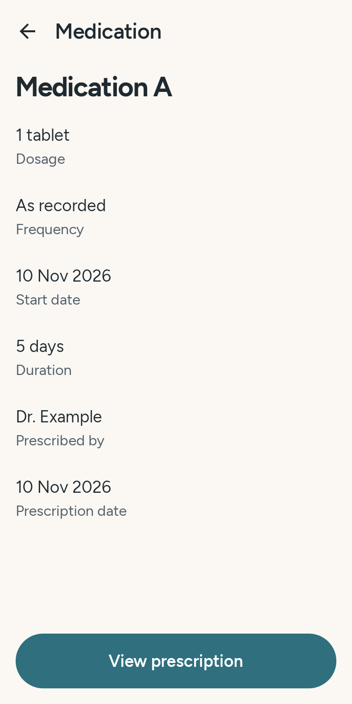
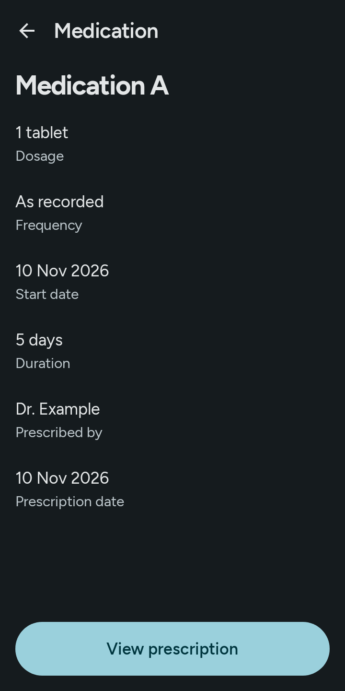
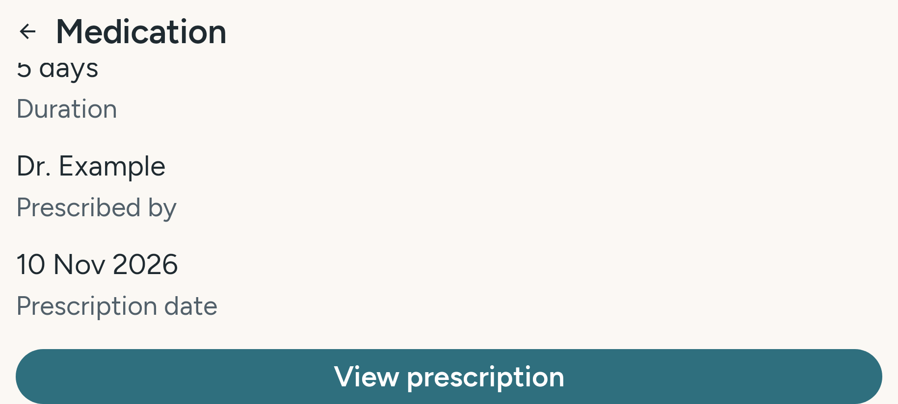

<!-- Co-authored-by: ChatGPT <noreply@openai.com> -->
# Medication detail (US-35)

Synthetic recorded data rendered by `MedicationDetailScreenTest` in light and dark themes,
and in landscape at 200% font scale after scrolling to the action. These use the current M2
appointment-detail pattern, with the standard toolbar and shared components, not the later
Paper lake toolbar or full Figma restyle.

| Light | Dark |
|---|---|
|  |  |

